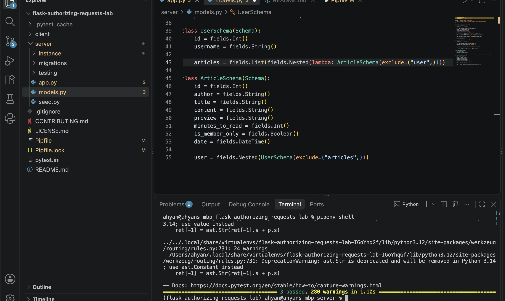

# Lab: Authorizing Requests

## Scenario

This lab continues work on a blog site and adds features that only logged-in users can access. Articles have an `is_member_only` flag, and two new endpoints return only those articles to users who are signed in.

## Tools & Resources

- [GitHub Repo](https://github.com/learn-co-curriculum/flask-authorizing-requests-lab)
- [What is Authentication? - auth0](https://auth0.com/intro-to-iam/what-is-authentication)
- [API - Flask: class flask.session](https://flask.palletsprojects.com/en/2.2.x/api/#flask.session)

## Set Up

There is starter code for a Flask API backend and a React frontend. To get set up, run:

```bash
pipenv install; pipenv shell
npm install --prefix client
cd server
flask db upgrade
python seed.py
```

Run the tests with `pytest -x`. Start the Flask server with:

```bash
python app.py
```

Run React in another terminal from the root project directory with:

```bash
npm start --prefix client
```

## Features

Anyone can view the public articles, with a limit of 3 page views per session for visitors who are not logged in. Logged-in users can also view member-only articles.

| Route | Method | Description |
| --- | --- | --- |
| `/login` | POST | Logs in a user by username and stores `user_id` in the session |
| `/logout` | DELETE | Clears `user_id` from the session |
| `/check_session` | GET | Returns the logged-in user, or 401 |
| `/articles` | GET | Lists all articles |
| `/articles/<id>` | GET | Shows one article (3 free views for logged-out visitors) |
| `/members_only_articles` | GET | Lists member-only articles. 401 if not logged in |
| `/members_only_articles/<id>` | GET | Shows one member-only article. 401 if not logged in |

## How It Works

`MemberOnlyIndex` and `MemberOnlyArticle` check `session.get('user_id')` at the start of each `get()` method.

- If there is no `user_id` in the session, the response is `{'error': 'Unauthorized. Please log in.'}` with a 401 status.
- If the user is logged in, `MemberOnlyIndex` returns every article where `is_member_only` is true, and `MemberOnlyArticle` returns the article matching the ID.
- `MemberOnlyArticle` returns a 404 if no article has that ID.

## Screenshot



## Testing

```bash
pytest
```

All tests in `server/testing/app_test.py` should pass.
